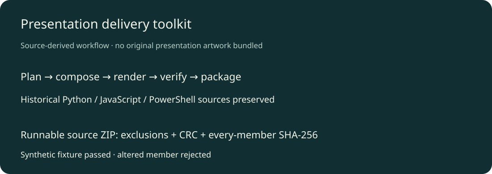

# 演示文稿交付工具集

保全数字媒体项目的多轮答辩制作、截图审查、原生文字嵌入、逐页检查与团队提交包脚本。代码展示从排版到交付校验的工作过程；不同修订版分别保留，不把它们说成多个独立产品。



## 可直接运行

Python3.12及更新版本，无额外依赖。为自己审查过的源码目录创建轻量ZIP，并逐项核对CRC和SHA-256：

```sh
python scripts/package_source.py ./my-reviewed-source ../my-source.zip
```

输出ZIP必须位于源目录外且尚不存在。自动跳过常见依赖、构建目录、真实环境变量文件、日志与符号链接；`.env.example`允许作为无值示例。它不是通用隐私识别器，打包前仍需检查源码内容。不会修改或删除原目录。

## 历史源码

`archive/`按团队包、审查方案、正式答辩与服务价值修订版保存完整源文件，清单见[源索引](docs/source-index.json)。历史代码用`.txt`结尾防止直接执行；个人机器路径和其他成员姓名改为占位。Python函数及控制流保持；原作图片、字体、真实团队资料、二进制PPT/PDF与编译产物未打包。

原排版脚本使用本机Codex演示文稿运行库、Sharp/Canvas、合法字体、浏览器及可选Microsoft Office。它们不是该仓库可自由再分发的依赖，也不是当前公开npm安装即可完整重建的方案。历史脚本需使用者自行适配路径与合法输入；原生PPT/字体、Office自动化和整套渲染链没有在本次公开包上执行，不声称已复原。

## 验证、更新与计划

2026-10-26：历史Python/JavaScript语法检查；PowerShell只解析、不执行。真实隔离目录包含合成源码、环境示例私密文件和缓存，实际ZIP仅保留2个源码/说明文件，CRC与各成员指纹通过；故意修改一个成员后验证器拒绝。原始项目和旧脚本未执行或修改。

后续可将历史排版链适配为可公开安装的引擎；当前交付定位为源码档案与可直接运行的安全打包子工具。真实演示素材/项目数据尚未全部托管，原目录继续保留。

原创代码采用MIT；外部运行库、字体、作品素材各依其原许可，不随此仓库重新授权。
